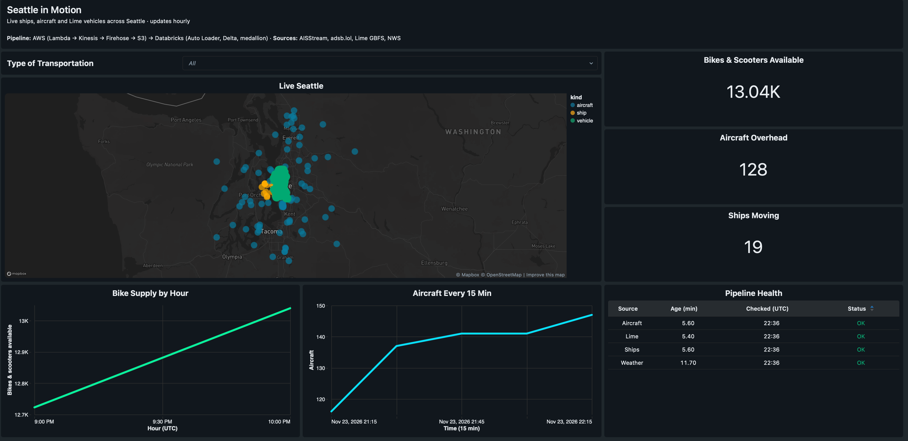
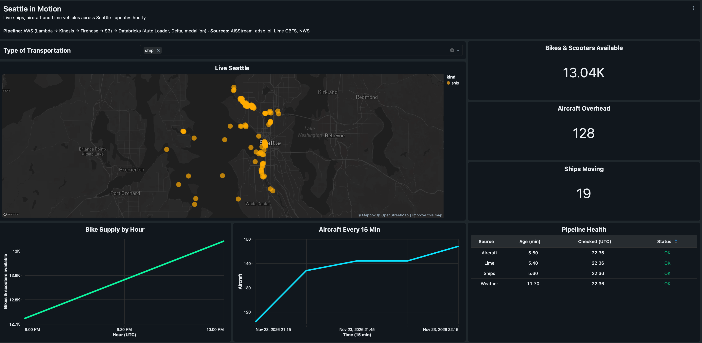
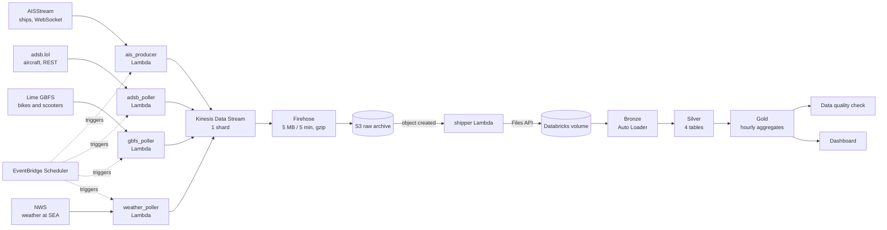
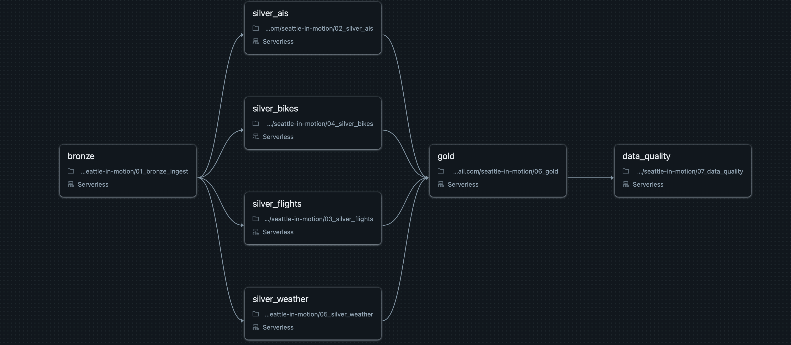

# Seattle in Motion

**A live data pipeline that tracks the ships, planes and scooters moving around Seattle.**

Every minute or so, this project pulls real positions for boats in Elliott Bay, aircraft around SEA, and every Lime bike and scooter parked in the city, along with the weather at the airport. AWS handles the collection, Databricks turns it into clean tables, and a dashboard shows what the city looks like right now.

I built it to get hands-on with streaming on AWS (alongside studying for the AWS Data Engineer Associate cert) and to have a project that uses data I can actually see out my window.

<p align="center">
  
  <br>
  <em>The live dashboard: aircraft in blue, ships in orange, Lime bikes and scooters in green</em>
</p>

---

## What it does

- Collects live data from **4 public sources**, around the clock
- Streams everything through **Kinesis** into an S3 archive
- Builds a **bronze / silver / gold** lakehouse in Databricks with exactly-once ingestion
- Puts ships, planes and scooters on the same **H3 hexagon grid** so they can be compared
- Runs on an **hourly schedule** with data quality checks and email alerts on both AWS and Databricks
- Costs roughly **$15 to $20 a month** to keep running (estimate, mostly the Kinesis shard)

## A closer look

Filtering the map to ships zooms into Elliott Bay. You can pick out the working waterfront, the Duwamish shipyards, the fishing fleet up in Lake Union, and the ferries crossing to Bremerton and Bainbridge.

<p align="center">
  
  <br>
  <em>Ships only, around Elliott Bay and Puget Sound</em>
</p>

## Architecture



Inside Databricks, one hourly job runs the whole lakehouse. Bronze loads first, the four silver tables build in parallel, then gold, then a data quality check that fails the run if any source has gone quiet.

<p align="center">
  
  <br>
  <em>The hourly Databricks job</em>
</p>

## Data sources

| Source | What it gives | How often | Access |
|---|---|---|---|
| [AISStream](https://aisstream.io) | Ship positions, speed, course, names | Continuous (WebSocket) | Free API key |
| [adsb.lol](https://adsb.lol) | Aircraft positions, altitude, callsign, type | Every minute | Free, no key |
| [Lime GBFS](https://www.seattle.gov/transportation/projects-and-programs/programs/bike-program/bike-share) | Every parked Lime bike and scooter in Seattle | Every 2 minutes | Free, no key |
| [National Weather Service](https://www.weather.gov/documentation/services-web-api) | Weather at the SEA airport station | Every 10 minutes | Free, no key |

## The tables

| Layer | Table | What's in it |
|---|---|---|
| Bronze | `events` | Every raw record exactly as it arrived, plus the file it came from |
| Silver | `ais_positions` | Cleaned ship positions, deduped, with H3 cell |
| Silver | `aircraft_states` | Cleaned aircraft positions in metric units, with H3 cell |
| Silver | `vehicle_snapshots` | One row per Lime vehicle per snapshot, with H3 cell |
| Silver | `weather_obs` | Deduped weather observations |
| Gold | `vehicle_supply_15min` | Available vehicles per hexagon every 15 minutes |
| Gold | `vessel_activity_hourly` | Ships seen and moving, average speed |
| Gold | `air_traffic_15min` | Aircraft seen, on the ground, and below 3,000 m |
| Gold | `city_pulse_hourly` | One row per hour tying all four sources together |
| Gold | `dq_freshness` | How old each source's newest data is, every run |

## Decisions and things that went wrong

This is the part I'd want to read if I were reviewing someone else's project, so here's what actually happened.

**Databricks Free Edition can't read my S3 bucket.** Free Edition is serverless only and locks down outbound network access, so the normal approach (Auto Loader pointed at S3) wasn't an option. I flipped the direction: a small Lambda fires on every new Firehose file and pushes it into a Unity Catalog volume through the Databricks Files API. Auto Loader picks it up from there. In a paid workspace I'd delete the shipper and read S3 directly through an external location.

**My first aircraft source blocked AWS.** I started with OpenSky, but every call from Lambda timed out. Their docs say they may block AWS and other cloud providers because of abuse. I switched to adsb.lol and kept the exact same output fields (converted to the same units), so nothing downstream had to change.

**A tugboat doing 102 knots.** While checking silver, one boat showed up at 102.3 knots. That's the AIS code for "speed not available," not a real speed. Same story for a course of 360. I convert both to null in silver and backfilled the rows that were already loaded. Max speed now sits around 18 knots, which matches the ferries.

**Weather and mobility don't line up in time.** The weather station posts about once an hour and runs a bit behind, so an exact hour-to-hour join left the weather columns empty. Gold uses an as-of join instead: each hour gets the most recent observation at or before it.

**Running WebSockets in Lambda.** A WebSocket wants a long-lived connection, and Lambda stops at 15 minutes. The AIS producer streams for about 14.5 minutes, flushes, and exits, and EventBridge starts a new run every 15 minutes. That leaves a few seconds of gap per cycle. I accepted that for cost reasons (it fits in the Lambda free allowance). For zero gaps I'd move it to a small Fargate task.

**Hourly batches instead of an always-on stream.** Data arrives continuously, but Databricks runs Structured Streaming with `availableNow` on an hourly schedule. It keeps the same checkpointing and exactly-once guarantees and only uses compute for a few minutes an hour. Databricks suggested a file-arrival trigger, but files land every 5 minutes, which would have meant about 12 runs an hour for no real benefit.

**One Kinesis stream, one shard.** On-demand mode charges per stream per hour, which adds up to about $29 a month per stream. One provisioned shard is about $11 and handles all four sources with plenty of room. Every record carries a `source` field and bronze splits them back out.

## Monitoring

- **AWS side:** CloudWatch alarms on errors for all five Lambdas, plus Kinesis read lag and write throttling. Alerts go to email through SNS.
- **Databricks side:** the last task in the job checks how fresh each source is and fails the run if one goes quiet (30 minutes for aircraft and bikes, 45 for ships, 120 for weather). A failed run sends an email.
- **Dashboard:** a pipeline health table shows each source's age and an OK or STALE status.

## Repo layout

```
seattle-in-motion/
├── aws/
│   └── lambdas/
│       ├── kinesis_util.py      shared helper: batch, retry, newline-delimit
│       ├── ais_producer.py      AISStream WebSocket (14.5 min runs)
│       ├── adsb_poller.py       adsb.lol aircraft, every minute
│       ├── gbfs_poller.py       Lime GBFS, every 2 minutes
│       ├── weather_poller.py    NWS station KSEA, every 10 minutes
│       └── shipper.py           S3 to Databricks volume via Files API
├── databricks/
│   ├── 00_setup.sql             catalog, schemas, volumes
│   ├── 01_bronze_ingest.py      Auto Loader into bronze
│   ├── 02_silver_ais.py
│   ├── 03_silver_flights.py
│   ├── 04_silver_bikes.py
│   ├── 05_silver_weather.py
│   ├── 06_gold.sql
│   └── 07_data_quality.py
└── docs/
    ├── dashboard_all.png
    ├── dashboard_ships.png
    └── job_graph.png
```

## Running it yourself

You'll need an AWS account, a Databricks workspace (Free Edition works), and a free AISStream key.

1. Run `databricks/00_setup.sql` and create a Databricks access token.
2. Store your keys in SSM Parameter Store under `/seattle/...`.
3. Create a Kinesis stream (`seattle-motion`, 1 provisioned shard).
4. Deploy the five Lambdas in `aws/lambdas/` and schedule the four producers with EventBridge Scheduler.
5. Create a Firehose stream from Kinesis to S3 with the prefix `raw/!{timestamp:yyyy/MM/dd/HH}/`, and point the bucket's object-created event at the shipper.
6. Import the notebooks and wire them into a job: bronze, then the four silver tasks in parallel, then gold, then data quality.

Use region `us-west-2` throughout, and set a billing alert before you start.

## What I'd add next

- Forecast Lime vehicle supply per hexagon for the next hour, using time of day and weather
- Flag unusual events, like a ship stopped in a shipping lane or a plane circling in a holding pattern
- Measure Washington State Ferries on-time performance against their published schedule
- Move the AWS setup into Terraform so the whole thing deploys with one command

## Tech

AWS Lambda, EventBridge Scheduler, Kinesis Data Streams, Amazon Data Firehose, S3, SSM Parameter Store, CloudWatch, SNS, Databricks (Unity Catalog, Auto Loader, Structured Streaming, Delta Lake, Jobs, AI/BI Dashboards), Python, PySpark, SQL, H3
